<div align="center">

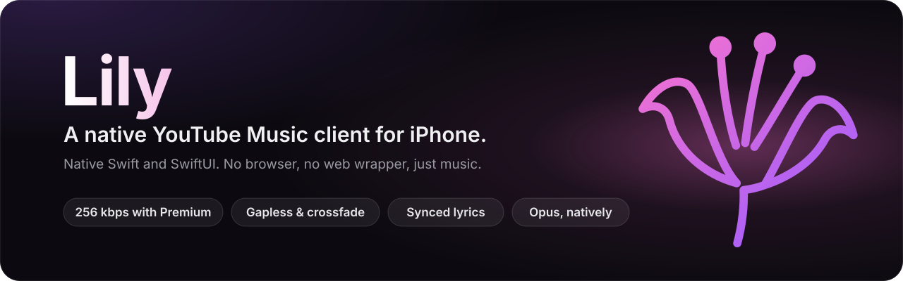

<br>

[](https://github.com/Visxoz/Lily-ios/releases/latest)
[](https://github.com/Visxoz/Lily-ios/releases)
[](https://github.com/Visxoz/Lily-ios/actions/workflows/ci.yml)
[](#install)
[](#made-for-iphone-duo)
[](#under-the-hood)
[](#under-the-hood)
[](LICENSE)

<br>

<a href="https://intradeus.github.io/http-protocol-redirector?r=altstore://source?url=https://github.com/Visxoz/Lily-ios/releases/latest/download/source.json"></a>&nbsp;&nbsp;<a href="https://intradeus.github.io/http-protocol-redirector?r=sidestore://source?url=https://github.com/Visxoz/Lily-ios/releases/latest/download/source.json"></a>
<br>
<a href="https://intradeus.github.io/http-protocol-redirector?r=feather://source/https://github.com/Visxoz/Lily-ios/releases/latest/download/source.json"></a>&nbsp;&nbsp;<a href="https://github.com/Visxoz/Lily-ios/releases/latest"></a>

<br>

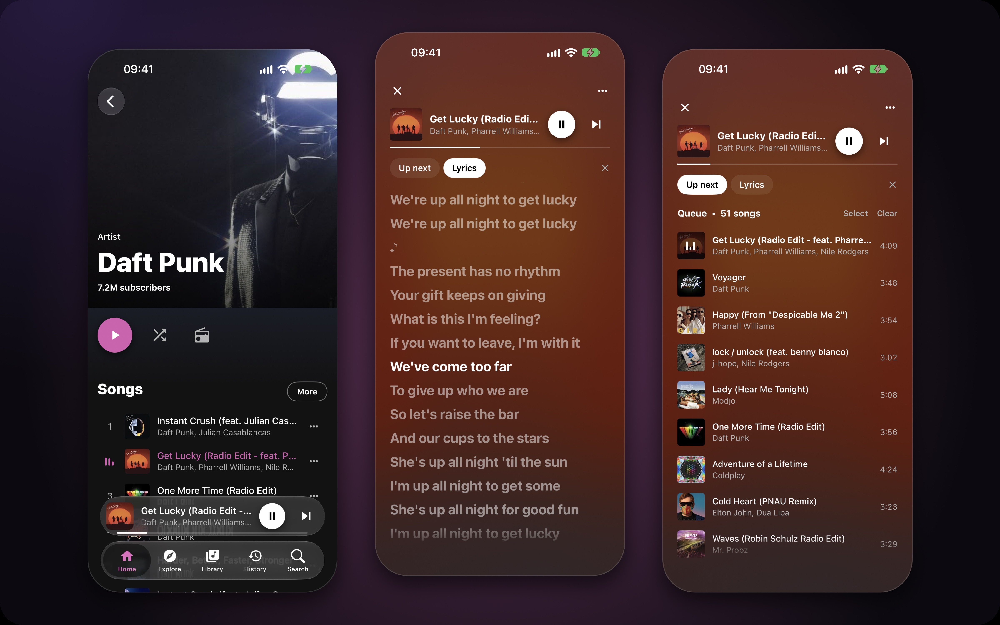

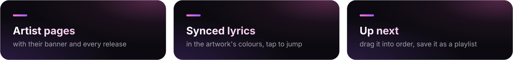

<br>

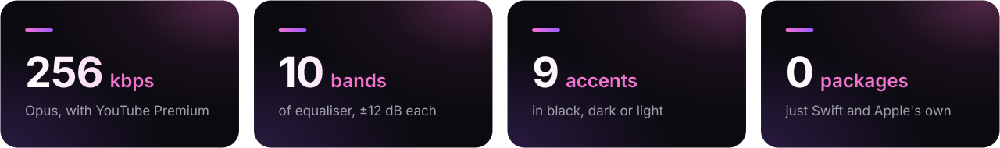

<br>

**[Tour](#a-look-around)** · **[Looks](#make-it-yours)** · **[Sound](#sounds-as-good-as-youtube-gets)** · **[Offline](#take-it-offline)** · **[iPhone Duo](#made-for-iphone-duo)** · **[Install](#install)** · **[Your account](#your-account)** · **[Under the hood](#under-the-hood)**

</div>

## Why Lily

<table>
<tr>
<td width="33%" valign="top">

### Sounds better
256 kbps Opus with Premium, gapless playback, a crossfade of your chosen length, volume levelling, a ten-band equaliser, and crossfeed, mono and balance for headphones.

</td>
<td width="33%" valign="top">

### All of YouTube Music
Radio, autoplay, Smart Shuffle, repeat, history and search with recent searches. Speed dial on Home, and artist pages with the whole discography. Songs, albums and playlists download to play offline.

</td>
<td width="33%" valign="top">

### Looks the part
Pure black and orchid out of the box, or dark or light, in eight other accents including one that follows the song's artwork. Pages are tinted to match, and Now Playing takes on the artwork's colours.

</td>
</tr>
<tr>
<td width="33%" valign="top">

### Lyrics and queue
Swipe up from the artwork for synced lyrics you can tap to jump to, and a queue you drag into order, edit several songs at a time, and save as a playlist.

</td>
<td width="33%" valign="top">

### At home on iPhone
The lock screen, Control Center, the volume buttons and your AirPods, Last.fm, a Liquid Glass tab bar and icon, and [layouts of its own](#made-for-iphone-duo) on iPhone Duo. Reopens on the song you left, at the second you left it.

</td>
<td width="33%" valign="top">

### Truly native
Swift and SwiftUI from top to bottom, on Apple's own audio engine. No web views, no wrappers, nothing but the app.

</td>
</tr>
</table>

## A look around

<table>
<tr>
<td width="25%">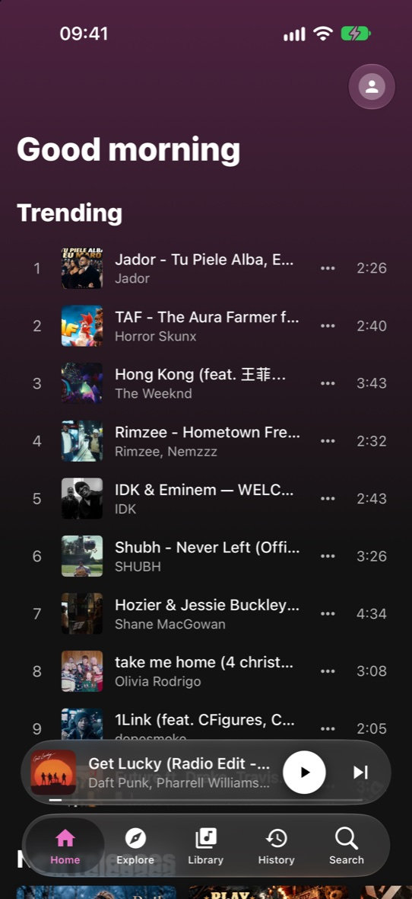</td>
<td width="25%">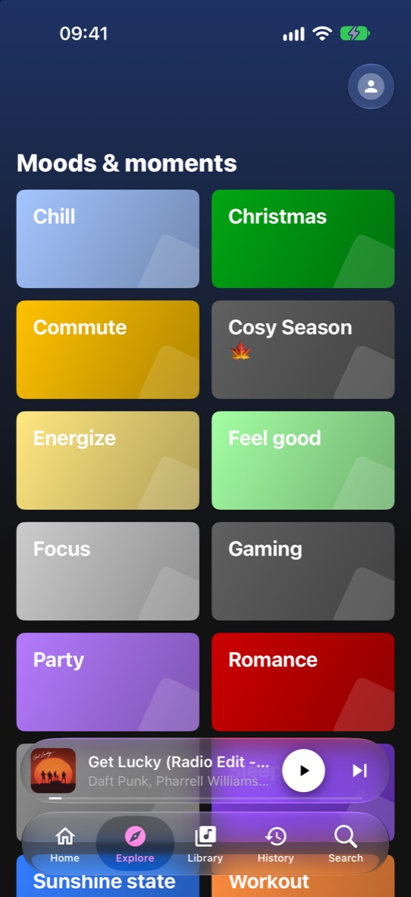</td>
<td width="25%">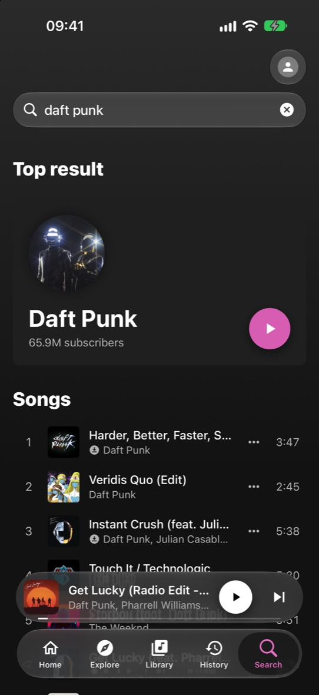</td>
<td width="25%">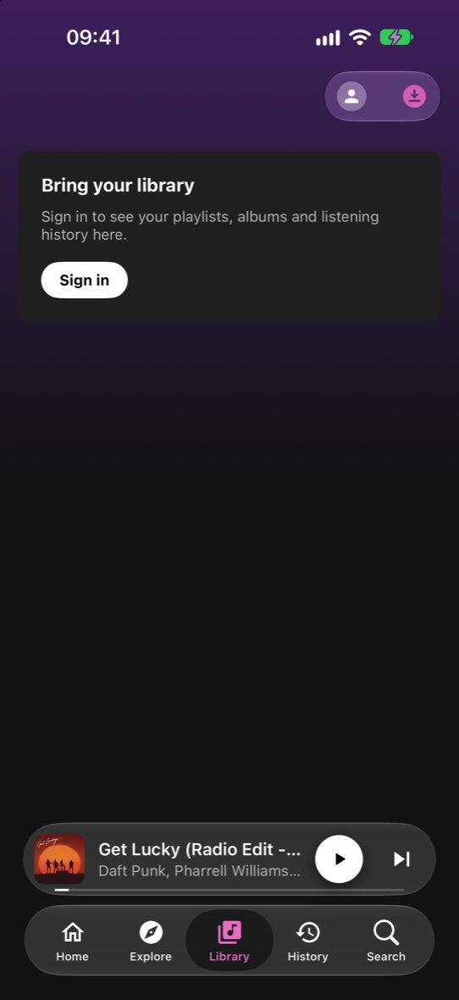</td>
</tr>
<tr>
<td align="center"><b>Home</b> · in Dark, tinted with your accent</td>
<td align="center"><b>Explore</b> · moods, moments and more</td>
<td align="center"><b>Search</b> · with a top result</td>
<td align="center"><b>Library</b> · yours when signed in, with downloads</td>
</tr>
</table>

## Make it yours

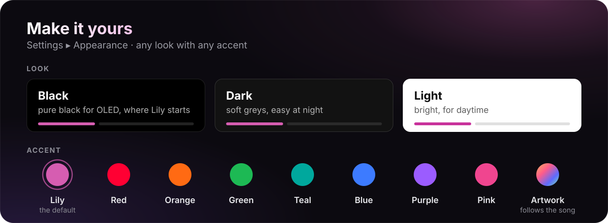

<table>
<tr>
<td width="25%">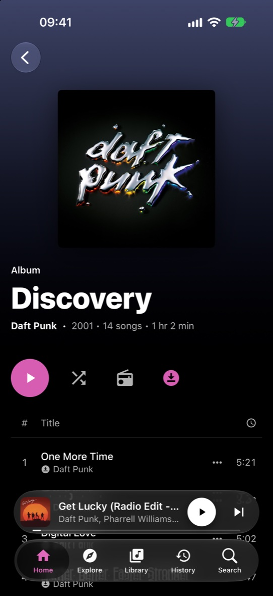</td>
<td width="25%">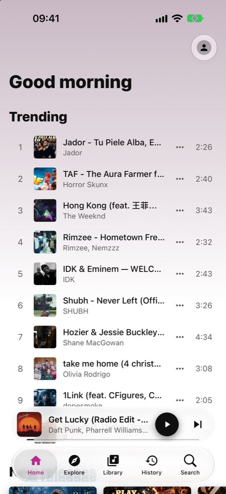</td>
<td width="25%">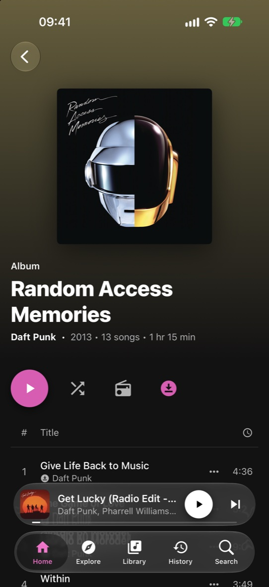</td>
<td width="25%">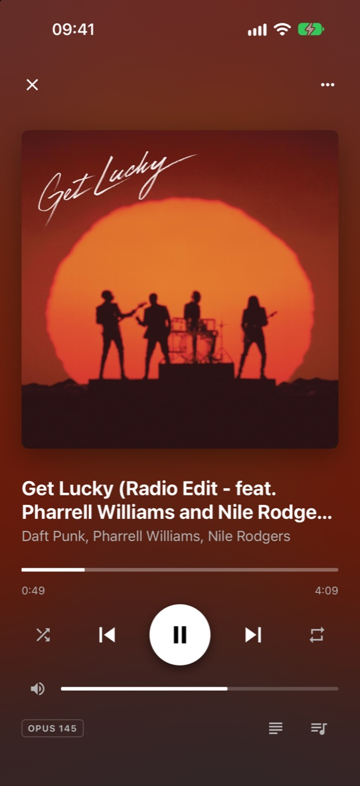</td>
</tr>
<tr>
<td align="center"><b>Black</b> · for OLED screens</td>
<td align="center"><b>Light</b> · for daytime</td>
<td align="center"><b>Albums</b> · tinted from the cover</td>
<td align="center"><b>Now Playing</b> · in the artwork's colours</td>
</tr>
</table>

Lily starts in pure black with its own orchid. Pick another look and accent in **Settings ▸ Appearance**: Lily, Red, Orange, Green, Teal, Blue, Purple, Pink, or **From the artwork**.

## Sounds as good as YouTube gets

<table>
<tr>
<td width="62%">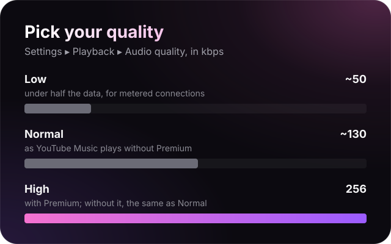</td>
<td width="38%">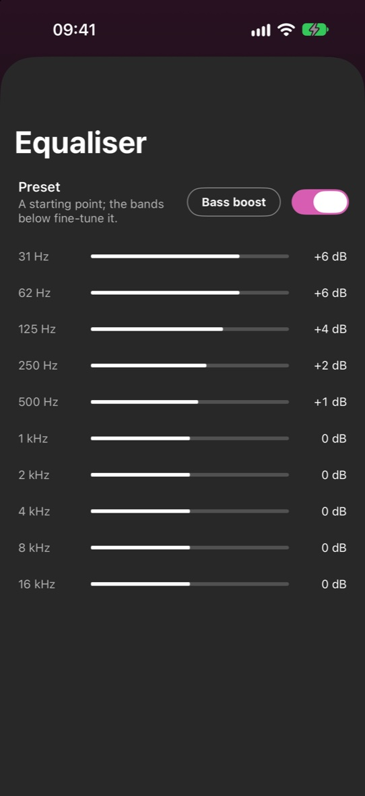</td>
</tr>
</table>

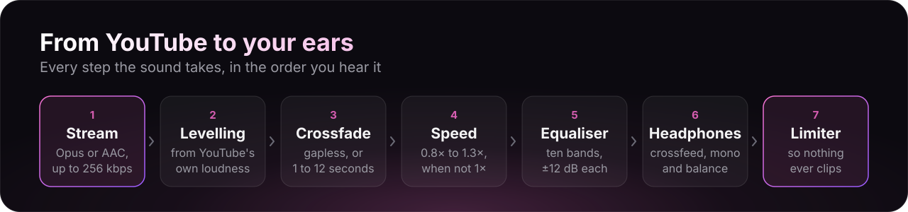

| Feature | What it does |
| --- | --- |
| **Premium streams** | Signed in with Premium on High, songs play in YouTube's 256 kbps formats, and Now Playing says so. Music videos swap to their song versions to get them. |
| **Normalise volume** | Plays every track at a similar loudness, from YouTube's own measurement: loud ones turned down and quiet ones up, at Normal or a Quiet level 6 dB lower, with a limiter so nothing clips. |
| **Gapless** | The next song is lined up 15 seconds early and follows without a gap, and the screen changes the moment the sound does. |
| **Crossfade** | Fades each song into the next over 6 seconds, or a length you choose from 1 to 12, cutting the silence at the joins. An album played in order still runs straight on, and skipping never fades. |
| **Equaliser** | Ten bands from 31 Hz to 16 kHz, ±12 dB each, with presets: Flat, Bass boost, Treble boost, Vocal, Rock, Electronic and Acoustic. Boosting turns the rest down to leave headroom. |
| **No clicks, no drop-outs** | Pausing ramps the sound down, and seeks and skips fade in. Unplug your headphones and the music pauses, or with **Pause when unplugged** off, carries on through the speaker; plug a pair in and it plays on through them. |
| **Rides out a lost connection** | A connection that drops is waited on for a minute. Gone longer, the song opens again where it stopped, a few times, then waits for you to press play, rather than skipping. |

## Take it offline

<table>
<tr>
<td width="62%" valign="top">

Tap the download button on an album or playlist, or **Download** in any song's menu, and it plays from the phone after that, online or not. Offline, the queue skips what isn't downloaded, and downloaded albums and playlists still open.

| Feature | What it does |
| --- | --- |
| **Smart downloads** | Keeps 25 to 200 songs downloaded, from what you play and more like it, picked afresh each day. |
| **Stays current** | Downloaded albums and playlists pick up YouTube's changes once a day. |
| **Wi-Fi only** | Downloads wait for Wi-Fi rather than use mobile data or a hotspot, unless you say otherwise. |
| **Download quality** | Set apart from streaming: Low, Normal or High, which is 256 kbps Opus with Premium. |

Find them behind the download button at the top of Library, and the settings in **Settings ▸ Downloads**.

</td>
<td width="38%">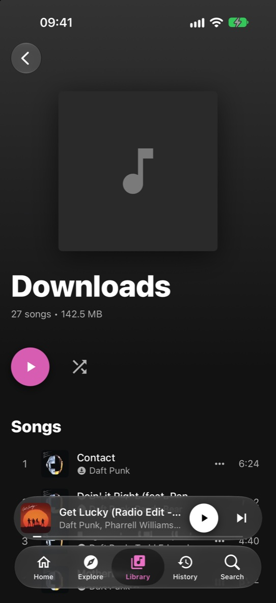</td>
</tr>
</table>

## Made for iPhone Duo

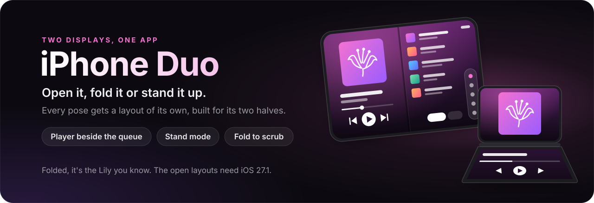

Folded, iPhone Duo's outer display is a phone like any other, and Lily is the app you know. Open it up and each screen is laid out again for the bigger display and its two halves.

<table>
<tr>
<td width="40%">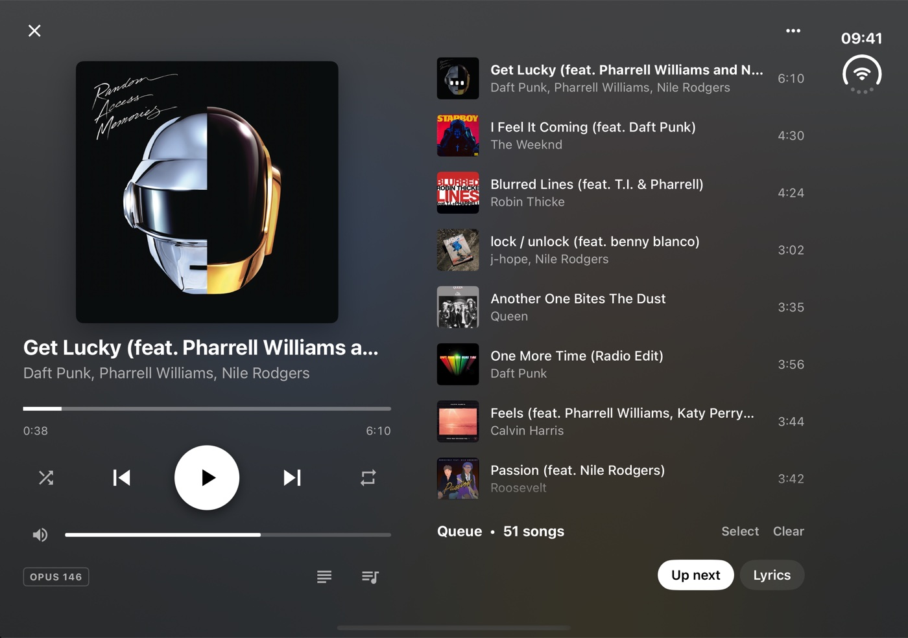</td>
<td width="40%">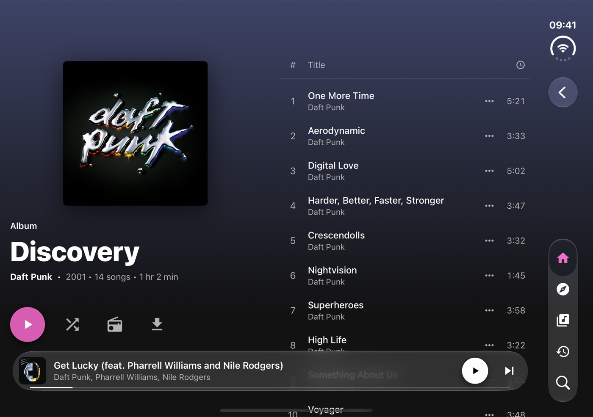</td>
<td width="20%">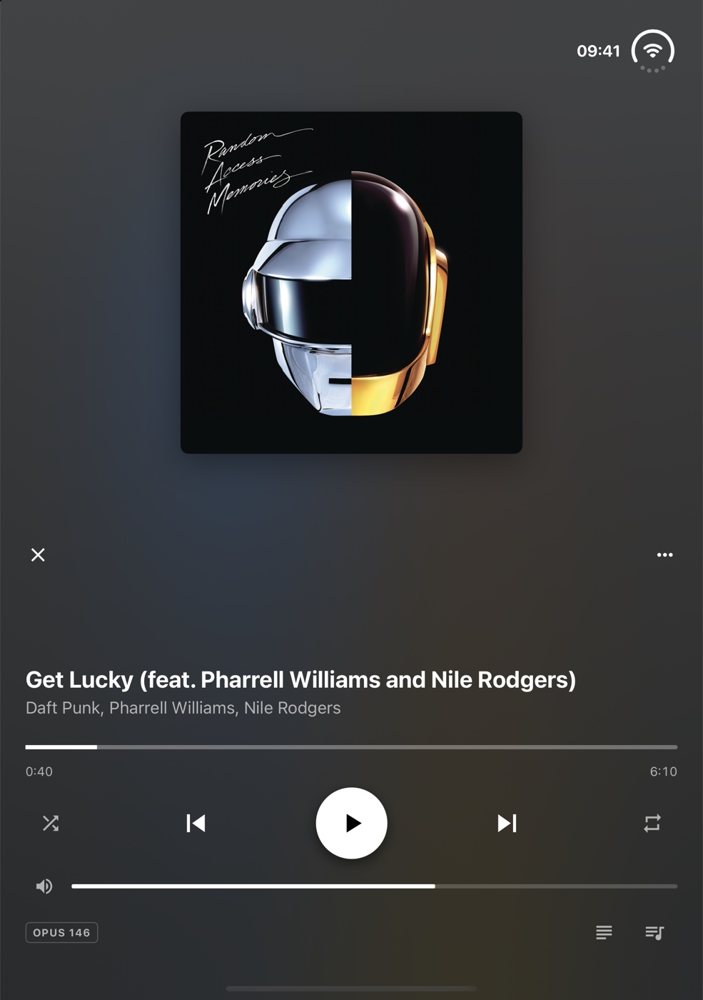</td>
</tr>
<tr>
<td align="center"><b>Open</b> · the player beside the queue or lyrics</td>
<td align="center"><b>Albums</b> · the header beside the tracks</td>
<td align="center"><b>Stood</b> · artwork up, controls down</td>
</tr>
</table>

| Feature | What it does |
| --- | --- |
| **Player beside the panel** | Open it wide and Now Playing puts the queue or lyrics beside the player, one on each half, with their buttons at the foot where your thumb reaches. |
| **Two-pane pages** | Albums and playlists put the cover, title and Play button on one half and the tracks on the other. Pages fit more columns, and their colour runs right under the tabs. |
| **Stand mode** | Half open it like a laptop and the artwork or lyrics face you from the upright half, with every control on the flat half. |
| **Fold to scrub** | Half open it like a book, rest it a moment, then fold it to skip back or open it to skip ahead, 10 seconds a step. Turn it on in **Settings ▸ Playback**. |

The open layouts need iOS 27.1 or later.

## Install

1. On your iPhone, tap **Add to AltStore**, **Add to SideStore** or **Add to Feather** at the top of this page.
2. Your store opens and adds Lily's source. Install Lily from it.
3. That's it: Lily works signed out straight away, and new versions show up in your store as updates.

If a button does nothing, add the source by hand: copy this link, and paste it in your store's **Sources** tab.

```
https://github.com/Visxoz/Lily-ios/releases/latest/download/source.json
```

Or grab `Lily.ipa` from the [latest release](https://github.com/Visxoz/Lily-ios/releases/latest) and open it with any of them.

> [!NOTE]
> Apps signed with a free Apple ID last seven days. AltStore and SideStore refresh them in the background; if they haven't, open the store and tap **Refresh All**.

> [!WARNING]
> Lily is an unofficial client. It uses YouTube's undocumented API, which is against YouTube's terms of service. Google could ask you to confirm you're not a bot or sign the session out, and could in principle restrict the account. A separate account is the safest choice.

## Your account

Tap the account button, then **Settings ▸ Account ▸ Sign in**, and sign in on Google's own page. The page closes by itself once you're in.

| Signed in | What you get |
| --- | --- |
| **Library** | Your playlists, albums and artists, where a playlist's menu can pin it to the top. |
| **Home** | Your own feed. |
| **History** | What you play here counts towards your YouTube Music history and recommendations, with the time you listened, as on the web, unless you turn off **YouTube history** in **Settings ▸ Account**. |
| **Your playlists** | Edited from their page: press and hold a song, then drag it into a new order, remove songs from their menu, or rename it, change who can see it, or delete it from **More** in its header. Making one public or unlisted needs a YouTube channel on the account. |
| **Saving** | Any other album or playlist can be saved to your library from its header, and artists subscribed to. |

The sign-in is kept in the iPhone's Keychain, for this device only. Google's page is shown in a private web view that's thrown away as soon as you're signed in. Lily renews the sign-in every hour, and should YouTube sign you out, it says so.

<details>
<summary><b>Connecting Last.fm</b></summary>
<br>

Tap **Settings ▸ Account ▸ Last.fm ▸ Connect**, then allow access on Last.fm's page. Plays scrobble from then on, including ones made while you were offline.

Building it yourself? Last.fm needs an [API account](https://www.last.fm/api/account/create). Put its key and secret in `Config/Secrets.xcconfig` as `LASTFM_API_KEY = …` and `LASTFM_API_SECRET = …`; without them, Settings says Last.fm is unavailable.

</details>

## Under the hood

Everything you see and hear is native code, written in Swift. A web view only appears while you sign in, to show Google's page.

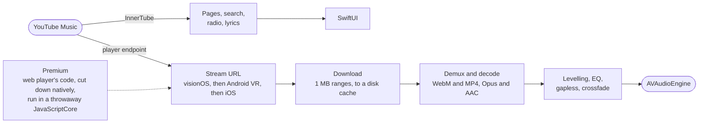

<details>
<summary><b>What it's built with</b></summary>
<br>

| Part | Built with |
| --- | --- |
| YouTube Music data | YouTube's InnerTube API, called directly (`YTMCore`) |
| Stream URLs | YouTube's player endpoint, called directly (`YTMCore/Streams`) |
| Premium URLs | A Swift tokenizer that cuts the player down, and JavaScriptCore |
| Demuxing | Its own WebM and MP4 readers (`YTMAudio`) |
| Opus and AAC | AudioToolbox |
| Audio output | AVAudioEngine, with its own in-process audio unit for the equaliser, crossfeed, balance and limiter |
| Interface | SwiftUI, with Lily's own icons drawn as shapes, and Now Playing's mesh gradient taken from the artwork |
| Networking | URLSession over HTTP/2 |
| Artwork | ImageIO, decoded at the size it's shown |
| Lock screen, AirPods and volume | MediaPlayer |
| Offline and Wi-Fi only | The Network framework |
| Google sign-in | WebKit, only while signing in |

Most YouTube clients get stream URLs that YouTube's player JavaScript has to unscramble. The visionOS client gets plain ones, so the app asks as that client and needs no JavaScript engine, falling back to Android VR and iOS if YouTube changes it. A client whose streams are cut off partway is asked last from then on, and the song carries on from the same byte with another client's copy. With Premium, the app unscrambles the web player's URLs itself, in a short-lived JavaScriptCore context with a cut-down copy of the player.

Apple's AudioToolbox decodes Opus, but can't read the WebM files YouTube keeps it in, so the app reads them itself and hands AudioToolbox the packets as they download. A seek past what has arrived is fetched first, found through the file's own index, and the gap before it after.

The app talks only to YouTube's hosts, plus Last.fm if you connect it, each checked against an allowlist. It follows the proxy set in iOS, or an HTTP or SOCKS5 proxy of your own entered in **Settings ▸ Account ▸ Proxy**, kept in the Keychain and used from the app's next start.

</details>

<details>
<summary><b>Building from source</b></summary>
<br>

You need Xcode 27.2. There are no dependencies to fetch.

```sh
cd Packages/YTMKit
swift test               # the unit tests
swift run ytmcheck all   # checks every page, stream and decode path against live YouTube
cd ../..
scripts/build-ipa.sh     # build/Lily.ipa, unsigned
scripts/lint.sh          # the lint CI runs
```

Or open `Lily.xcodeproj` and run it on the iPhone simulator.

Every release is built by [GitHub Actions](.github/workflows/release.yml) from main, never on anyone's computer. To check a download came from there, run `gh attestation verify Lily.ipa --repo Visxoz/Lily-ios --signer-workflow Visxoz/Lily-ios/.github/workflows/release.yml`.

| Path | What it holds |
| --- | --- |
| `App/` | The SwiftUI app |
| `Packages/YTMKit/Sources/YTMCore` | Models, the InnerTube API, page parsing, streams and Premium, persistence, Last.fm, artwork |
| `Packages/YTMKit/Sources/YTMAudio` | Streaming download, saving downloads, the WebM and MP4 readers, decoding and the audio engine |
| `Packages/YTMKit/Sources/YTMPlayback` | The queue, the player, Now Playing, Smart Shuffle, downloads, scrobbling |
| `Packages/YTMKit/Sources/ytmcheck` | A macOS tool that checks the app's YouTube paths are still working |

</details>

## Licence

Lily for iPhone is a port of [Lily for Windows](https://github.com/Visxoz/lily) and, like it, free software under the [GNU General Public License, version 3](LICENSE).

<br>

<div align="center">
<sub>Not affiliated with, endorsed by or connected to YouTube or Google. YouTube Music is a trademark of Google LLC.</sub>
</div>
